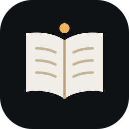
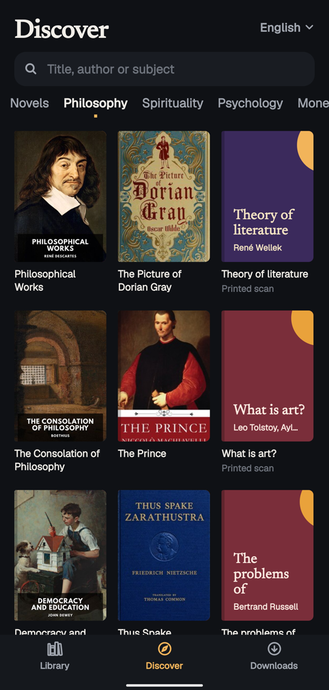
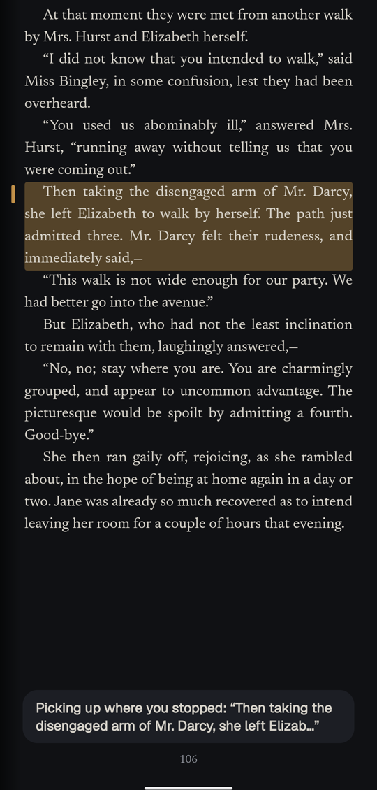
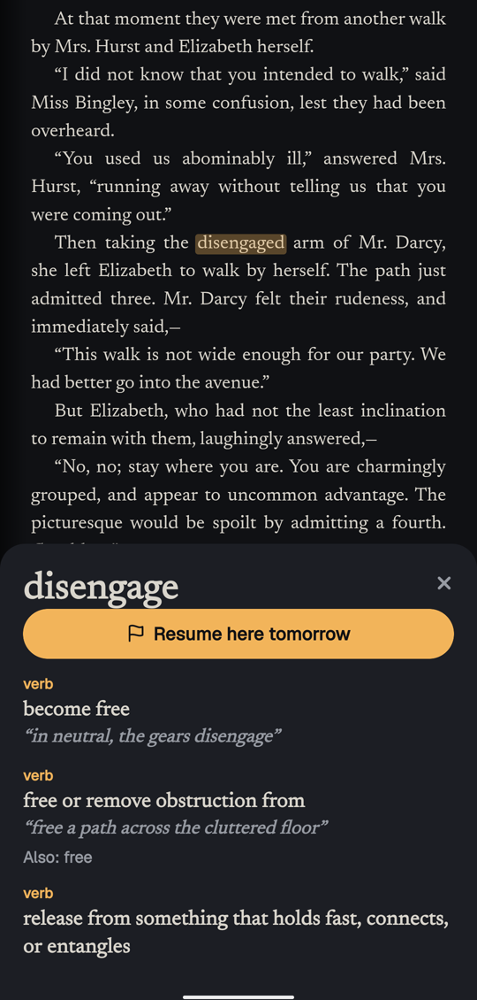
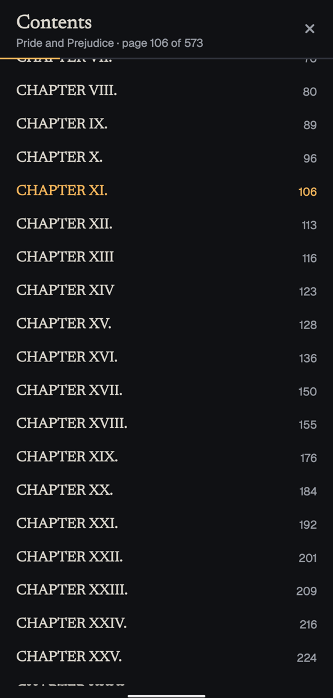

<p align="center">
  
</p>

<!-- identity -->
<p align="center">
  <b>सरस्वति नमस्तुभ्यं वरदे कामरूपिणि ।<br>
  विद्यारम्भं करिष्यामि सिद्धिर्भवतु मे सदा ॥</b><br>
  <i>Salutations, Sarasvatī, giver of boons: I begin to learn, may it always bear fruit.</i><br>
  <sub>Sarasvatī prayer, traditional</sub>
</p>
<!-- /identity -->

<p align="center">
  <b>असतो मा सद्गमय । तमसो मा ज्योतिर्गमय ।</b><br>
  <i>From the unreal lead me to the real; from darkness lead me to light.</i><br>
  <sub>Bṛhadāraṇyaka Upaniṣad 1.3.28</sub>
</p>

<p align="center">
  A book reader for your phone: every free book in reach, pages that turn like paper, and everything works offline.
</p>

<p align="center">
  
  
  
  
</p>

> *Vāgdevī* (वाग्देवी) is Saraswati as the goddess of the word: speech, learning and the book she carries.

## Install

**[Download the APK](https://github.com/Theyashsawarkar/vagdevi/releases/latest/download/vagdevi.apk)** (Android 10 or newer, about 50 MB).

Open the file on your phone. Android asks once to allow installing from your browser or files app; allow it, and install. New versions install over the old one and keep your books. [All releases](https://github.com/Theyashsawarkar/vagdevi/releases).

There's no account and nothing to sign in to. Everything you keep stays on your phone.

## What it does

- **Reads** PDF, EPUB, Markdown and pictures. Open a file with the **+** button, or from any other app.
- **Finds free books** from [Standard Ebooks](https://standardebooks.org), [Project Gutenberg](https://www.gutenberg.org) and the [Internet Archive](https://archive.org), by genre and language. These libraries carry books out of copyright, so recent books aren't there; open your own with **+**.
- **Turns pages like paper.** Tap right for next, left for back, the middle for the controls, or swipe the page with your finger. The speed is yours to set.
- **Five kinds of page:** paper, sepia, night, true black for OLED screens, and e-ink.
- **All kinds of PDFs:** scans included. They open as printed, and **Reading mode** turns them into text and pictures you can resize. Scans with no text inside stay as printed pages.
- **Contents at a glance:** a full index of the book that opens where you are. When a PDF doesn't list its chapters, they're found by reading its pages.
- **A resume mark:** press and hold a line, tap *Resume here tomorrow*, and the book opens on that paragraph next time. It stays on the paragraph even if you change the text size.
- **A dictionary built in:** press and hold any word, offline, about 150,000 English words (WordNet).
- **A library that sorts itself:** books go on genre shelves using their library's subjects, with favorites on top. Long-press to select several, to favorite, move or delete them, with an Undo.
- **Downloads that cope with bad networks:** a tab of their own with progress, speed and retry; pause, resume or cancel any of them; they carry on after a dropped connection or a restart, and each book is checked to be complete.

## When something goes wrong

Settings › **Share debug logs** sends the app's log, kept for a week on the phone, wherever you choose. Attach it to an [issue](https://github.com/Theyashsawarkar/vagdevi/issues).

## Building it

```sh
pnpm install
pnpm -C apps/server build
pnpm -C apps/mobile test
cd apps/mobile && npx expo prebuild --platform android && cd android && ./gradlew assembleRelease
```

`apps/mobile` is the app (Expo, React Native; the reader runs pdf.js in a WebView). `apps/server` builds the bundled dictionary, and holds a laptop server the app doesn't use yet: signing in and syncing come later.

## Credits and licence

Books belong to their libraries and authors: check the rights shown on each book, which vary by country. The dictionary is [WordNet](https://wordnet.princeton.edu). MIT licence.
